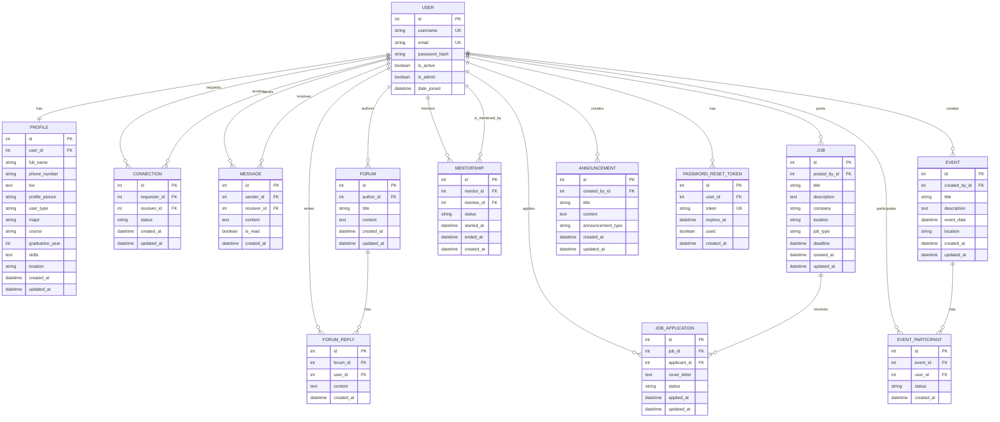

# 🗄️ Tukonect ER Diagram - Mermaid Version

## Visual Entity Relationship Diagram

## How to Use This Diagram

1. **Copy the Mermaid code** from the code block above
2. **Visit any Mermaid renderer**:
   - [Mermaid Live Editor](https://mermaid.live/)
   - [GitHub (supports Mermaid natively)](https://github.com/)
   - [GitLab (supports Mermaid natively)](https://gitlab.com/)
   - [Notion (supports Mermaid)](https://notion.so/)

3. **Export as Image**:
   - PNG: High quality for presentations
   - SVG: Scalable vector format
   - PDF: For documentation

## Alternative: Draw.io Version

If you prefer using Draw.io:

1. Go to [app.diagrams.net](https://app.diagrams.net/)
2. Create a new diagram
3. Use the "Entity Relationship" template
4. Recreate the diagram using the relationships described above

## Database Schema Summary

### Core Entities (10 tables)
- **USER**: Authentication and user management
- **PROFILE**: Extended user information
- **CONNECTION**: Social networking connections
- **MESSAGE**: Direct messaging system

### Content Entities (2 tables)
- **FORUM**: Discussion posts
- **FORUM_REPLY**: Forum post replies

### Career Development (2 tables)
- **JOB**: Job postings
- **JOB_APPLICATION**: Job applications with status tracking

### Event Management (2 tables)
- **EVENT**: Events and meetups
- **EVENT_PARTICIPANT**: Event participation tracking

### Mentorship (1 table)
- **MENTORSHIP**: Mentor-mentee relationships

### System Entities (2 tables)
- **ANNOUNCEMENT**: System announcements
- **PASSWORD_RESET_TOKEN**: Password recovery

### Total: 11 Entities with 19 Relationships

---

**Note**: This Mermaid diagram can be rendered in any Markdown viewer that supports Mermaid (like GitHub, GitLab, Notion) or converted to an image using online tools.
